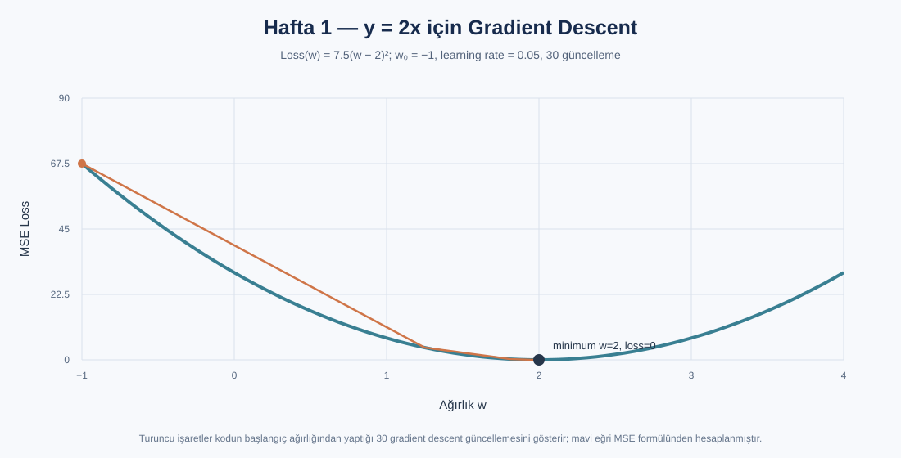

# Hafta 1 — Nöron ve gradient descent

Çalışma kodu: [week1.py](./week1.py)

## Grafik çıktısı

Grafikte y=2x örneği için loss eğrisi ve kodda kullanılan w₀=-1, learning rate=0.05 ile gradient descent'in ilk adımları gösterilir. Eğri MSE formülünden türetilmiştir; görsel çalışma kodunun kaydedilmiş bir terminal çıktısı değildir.
