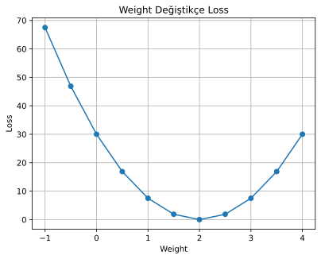
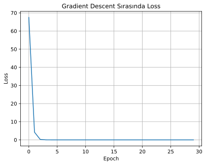

# Hafta 1 — Nöron ve Gradient Descent

Çalıştırma: `MPLBACKEND=Agg python week1.py` (grafikleri dosyaya kaydetmek için; grafik penceresi de açılabilir).

Kodun çalıştırılması iki grafik üretir:

- `hafta1_weight_loss.png`: farklı ağırlıklardaki MSE loss
- `hafta1_gradient_descent_loss.png`: kodun 30 eğitim adımındaki loss

## Çalıştırılmış çıktılar

