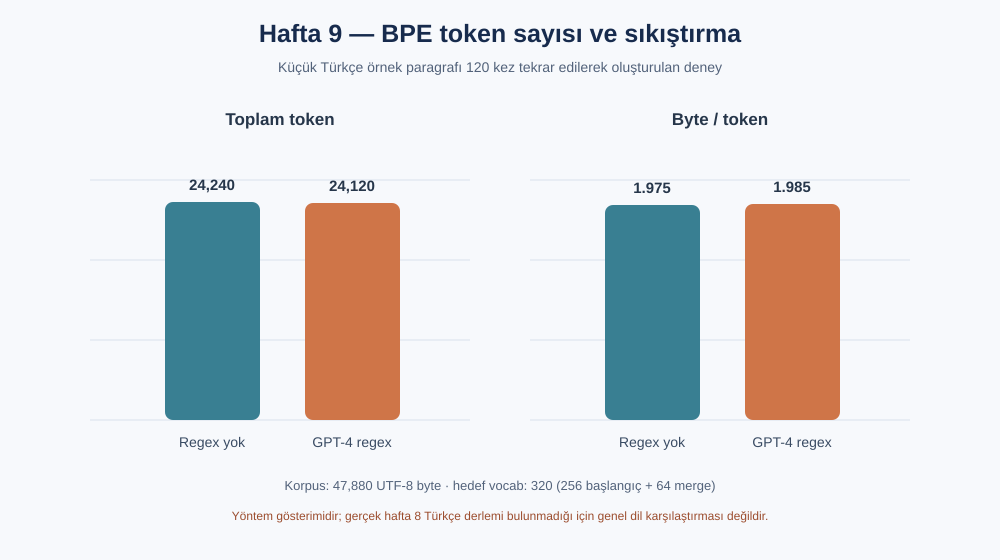

# YZ50 Hafta 9 — Byte Pair Encoding (BPE)

Bu hafta karakter seviyesindeki GPT'nin önüne, metni byte token'larına ayıran bir tokenizer yazdım. `tokenizer.py` BPE'yi sıfırdan uygular: byte tabanlı başlangıç sözlüğü kurar, en sık ardışık çifti tekrar tekrar birleştirir ve aynı merge sırasıyla encode eder. GPT-4 tarzı regex ön parçalama seçeneği de vardır.

## Çalıştırma

Python 3.10+:

```bash
python -m pip install -r requirements.txt
python main.py
python compare.py
python visualize.py
```

`main.py` önce `../hafta-8/data/turkish.txt` dosyasını arar. Bu dosya repoda bulunmadığı için şu an örnek Türkçe metni 120 kez tekrar ederek kullanır; rapordaki sonuçlar bu küçük, tekrar eden örnek içindir. Gerçek hafta 8 derlemesi eklendiğinde otomatik olarak onu kullanır. BPE hedef sözlüğü 320 byte/token'dır (256 başlangıç byte'ı + en çok 64 merge).

## UTF-8 gözlemi

ASCII harfler, boşluk ve noktalama birer byte'tır. Türkçedeki `ç, ğ, ı, ö, ş, ü, İ` gibi Latin Extended harfler UTF-8'de iki byte kullanır. Unicode kod noktası karakterin soyut kimliğidir; UTF-8 ise onu byte dizisine kodlar. Kod noktalarını doğrudan model sözlüğü yapmak mümkündür ama Unicode'un geniş ve seyrek alanı, farklı yazım biçimleri ve byte tabanlı dosya/veri arayüzleriyle uyum sorunları doğurur. Byte tabanı bütün UTF-8 girdilerini 256 başlangıç sembolüyle kapsar; BPE sık dizileri birleştirerek uzunluğu azaltır.

## Ölçüm ve yorum

Örnek metinde byte sayısı 47,880. Regex olmadan 24,240 token (1.975 byte/token), GPT-4 regex ön bölümlendirmesiyle 24,120 token (1.985 byte/token) çıktı. Küçük ve tekrarlı korpusta regex farkı sınırlı; gerçek, daha çeşitli metinde sonuç değişebilir. İlk merge'lerde `en`, `er`, `ler`, `de`, `an` gibi Türkçede sık tekrar eden parçalar görülüyor. BPE UTF-8 byte'ları birleştirebildiği için tek bir Türkçe harf de birden fazla byte'dan oluşan token olabilir.

`decode` birleştirdiği byte'ları UTF-8'e çözer. Token dizisi geçersiz UTF-8 üretirse `errors="replace"` ile U+FFFD (`�`) görünür; böylece decoder çökmek yerine hatalı byte'ı görünür kılar. Gerçek `encode` çıktısı round-trip'te metni kayıpsız geri verir.

GPT-4 regex'i harf dizilerini, sayıları, noktalama işaretlerini ve boşluk/yeni satır gruplarını önceden ayırır; BPE merge'leri bu sınırları aşamaz. Örnekte `Ankara'dan` → `Ankara`, `'d`, `an`; `İstanbul'da` → ` İstanbul`, `'d`, `a` olarak parçalanır. Kesme işaretinin `'d` parçası İngilizce contraction kuralından gelir; bu desen Türkçe morfoloji için özel yazılmadığından ekleri dilbilimsel olarak çözümlemez.

## cl100k_base karşılaştırması

`compare.py` aynı kısa anlamı taşıyan iki paragrafı `tiktoken` içindeki `cl100k_base` ile sayar. Bu örnekte Türkçe: 10 kelime / 33 token = 3.30 token/kelime; İngilizce: 13 kelime / 21 token = 1.62 token/kelime. Yerel tokenizer, Türkçe paragrafın kendisinde eğitildiğinde 17 token (1.70 token/kelime) verir. Türkçede ekler ve cl100k_base'in İngilizce ağırlıklı sık parçaları token sayısını artırabilir; fakat eğitim verisi, paragraf uzunluğu ve kullanılan tokenizer karşılaştırmayı etkiler. Bu nedenle bu küçük örnek genel dil performansı sonucu değildir.

`python visualize.py` komutu `outputs/index.html` ve üç PNG grafik üretir. `index.html` dosyasını tarayıcıda açınca deneyin kısa açıklaması, merge sıklıkları, regex karşılaştırması ve dil karşılaştırması görsel olarak incelenebilir.

## Önemli dosyalar

- `tokenizer.py`: byte-BPE eğitimi, regex ön bölümlendirme, encode/decode
- `main.py`: UTF-8 tablosu, merge deneyi, round-trip ve bozuk UTF-8 demosu
- `compare.py`: `cl100k_base` Türkçe/İngilizce sayımı
- `visualize.py`: PNG grafikler ve tarayıcıda açılan HTML raporu
- `results.md`: çalıştırma çıktıları ve merge karşılaştırması

Bu çalışma eğitim amaçlı küçük bir BPE uygulamasıdır; GPT-4 tokenizer'ının tam üretim uyarlaması değildir. Özellikle cl100k_base'in merge sözlüğü yüklenmediğinden birebir token-ID eşleşmesi iddia etmiyorum.


## Grafik çıktısı



Grafik `results.md` içinde raporlanan örnek korpus ölçümlerini gösterir. Veri küçük ve tekrar eden bir metindir.
